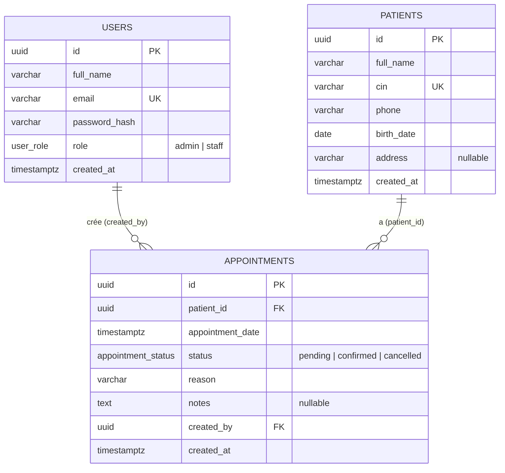

# ClinicFlow : Conception de la base de données

## 1. Schéma ERD

Le script correspondant est `backend/db/migrations/001_init.sql`.

## 2. Relations

| Relation | Type | Justification |
|---|---|---|
| `patients` → `appointments` | **1-N** | Un patient a plusieurs rendez-vous dans le temps. Un rendez-vous concerne un seul patient. La clé étrangère `patient_id` est donc du côté N, dans `appointments`. |
| `users` → `appointments` | **1-N** | Un utilisateur (staff ou admin) crée plusieurs rendez-vous. `created_by` garde la trace de qui a créé chaque rendez-vous. |

## 3. Règles de suppression

- `appointments.patient_id` : `ON DELETE CASCADE`. Un rendez-vous n'a pas de sens sans son patient, et la suppression d'un patient est réservée à l'admin. Pour des données médicales réelles, un soft delete (`deleted_at`) serait préférable.
- `appointments.created_by` : `ON DELETE RESTRICT`. On interdit de supprimer un utilisateur qui a créé des rendez-vous, afin de conserver l'historique de qui a fait quoi.

## 4. Contraintes

- **Clés primaires UUID** (`gen_random_uuid()`) : non devinables et non énumérables, contrairement à un entier auto-incrémenté.
- **`patients.cin` UNIQUE** : évite les doublons de patients. L'erreur PostgreSQL `23505` est traduite en réponse HTTP 409.
- **`users.email` UNIQUE** : l'email est l'identifiant de connexion.
- **ENUM PostgreSQL** pour `role` et `status` : seules les valeurs prévues sont acceptées, au niveau de la base.
- **`NOT NULL`** sur tous les champs obligatoires. Seuls `address` et `notes` sont facultatifs.
- **`password_hash`** : seul le hash bcrypt est stocké, jamais le mot de passe.

## 5. Index

| Index | Raison |
|---|---|
| `patients.cin` (via UNIQUE) | Recherche par CIN, créé automatiquement par la contrainte. |
| GIN trigram sur `patients.full_name` | La recherche `ILIKE '%mot%'` ne peut pas utiliser un index B-tree classique. L'extension `pg_trgm` le permet. |
| `appointments(appointment_date)` | Filtre par date et compteur du jour. |
| `appointments(status)` | Filtre par statut et compteurs pending/confirmed. |
| `appointments(patient_id, appointment_date)` | Rendez-vous d'un patient et vérification de la règle des 30 minutes. |

## 6. Règle métier : fenêtre de 30 minutes

> Un patient ne peut pas avoir 2 rendez-vous confirmés dans une fenêtre de 30 minutes.

Cette règle est vérifiée dans la couche service :

1. à la création d'un rendez-vous avec le statut `confirmed` ;
2. au changement de statut vers `confirmed` (le rendez-vous lui-même est exclu de la vérification).

La vérification se fait dans une transaction avec un verrou `SELECT ... FOR UPDATE` sur la ligne du patient, pour que deux requêtes simultanées ne puissent pas passer toutes les deux. Deux rendez-vous espacés d'exactement 30 minutes sont autorisés. Les rendez-vous `pending` et `cancelled` ne créent jamais de conflit.

Amélioration possible : une contrainte `EXCLUDE USING gist` avec `tstzrange` appliquerait la règle directement dans la base.

## 7. Pistes d'amélioration

- Soft delete (`deleted_at`) sur `patients`.
- Table `audit_logs` (qui a modifié quoi, et quand).
- Champ `is_active` sur `users` pour désactiver un compte sans le supprimer.
